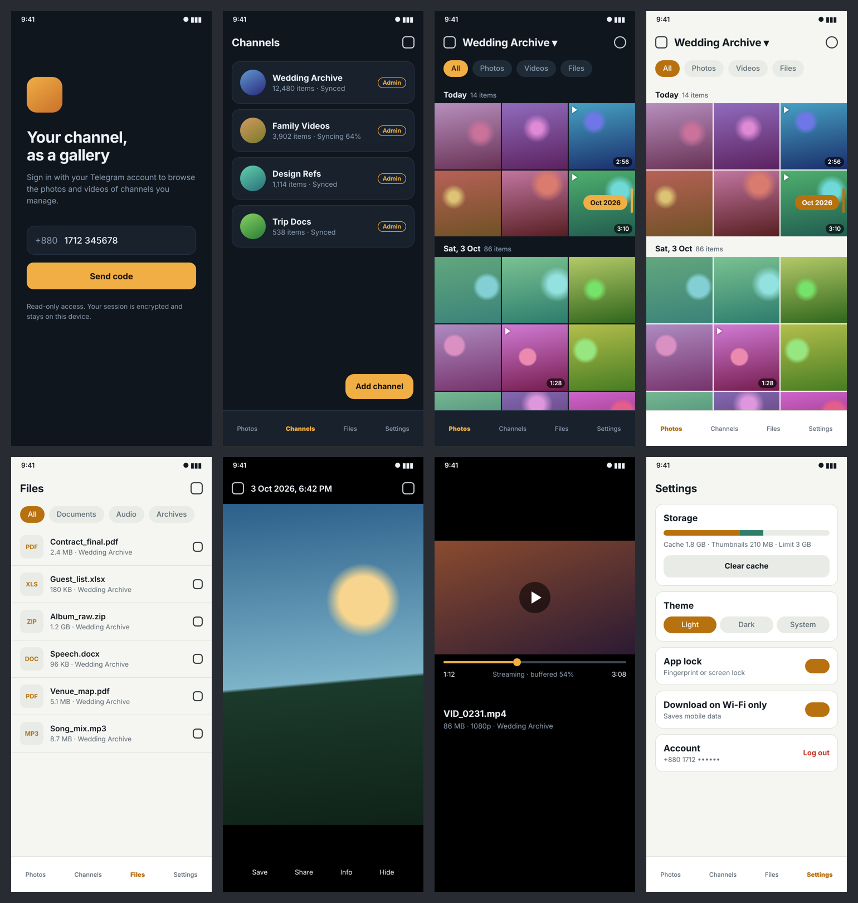
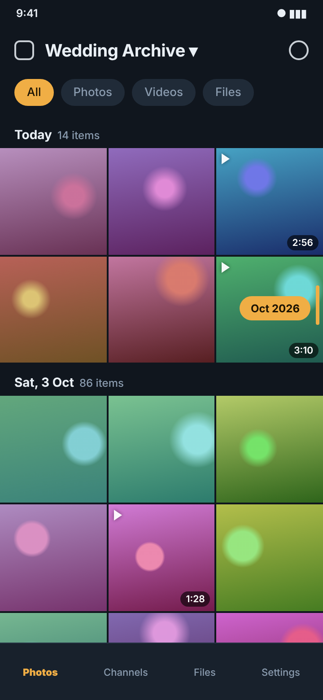
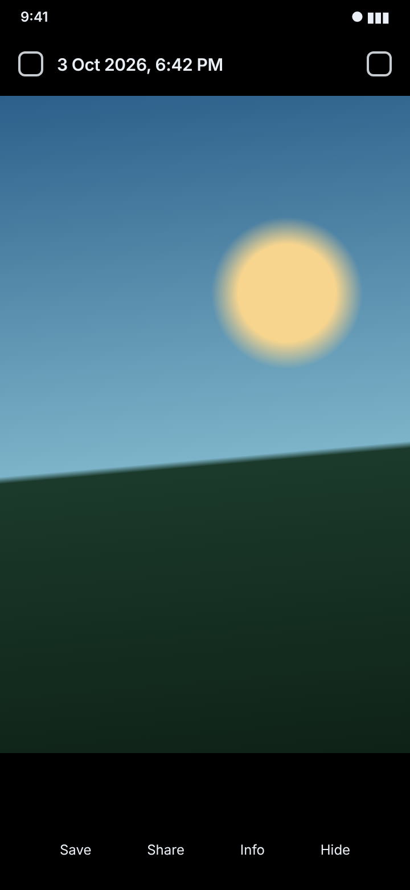
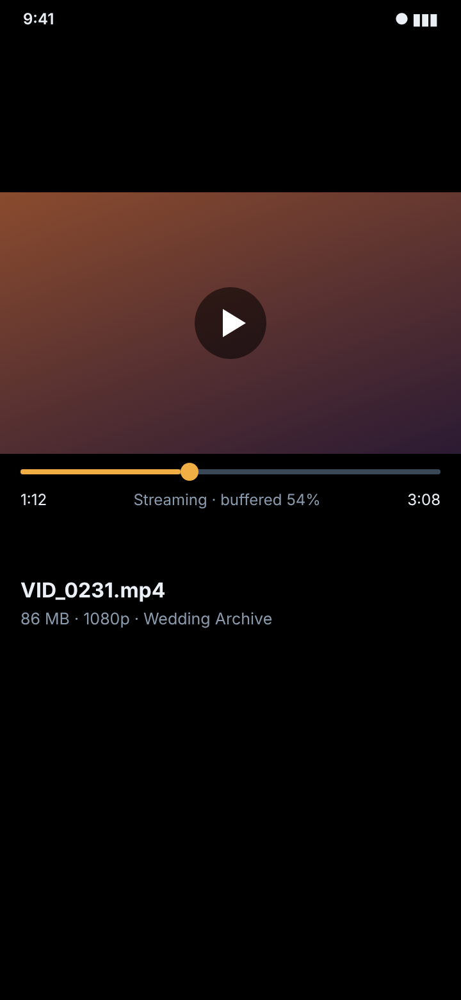
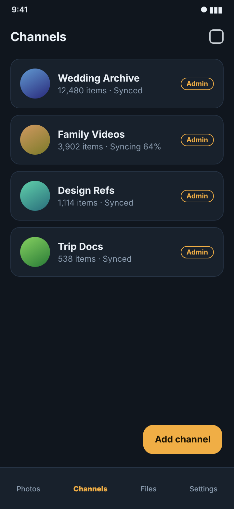
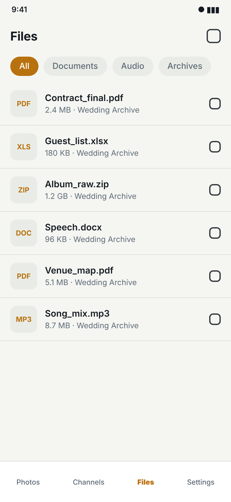

# 🚀 Amar

### Turn your Telegram Channels and Saved Messages into a butter-smooth, Google Photos-style gallery and personal cloud drive.

[-green.svg?style=flat-square&logo=android)](https://android.com)

 

---

## 🌟 Overview

Amar Gallery is a modern, high-performance native Android application that bridges Telegram's unlimited cloud storage with a premium Google Photos-inspired gallery interface. Built completely with  **TDLib (C)**, and **Media3 ExoPlayer**, it delivers an unmatched 60 FPS fluid media browsing experience for thousands of media items.

---

## ✨ Key Features

### ⚡ 60 FPS Smooth Scrolling
- **Zero UI-Thread Freezes:** Decoupled thumbnail caches (`StateFlow` + concurrent maps) prevent full-list re-grouping when new thumbnails arrive.
- **Background Grouping:** Timeline date-grouping (Today, Yesterday, etc.) and filtering are performed asynchronously on `Dispatchers.Default`.
- **Fast-Scroll Scrubber:** Fluid scrub bar with interactive month bubbles for navigating tens of thousands of items instantaneously.

### 🖼️ Instant Media Thumbnails
- **Zero-Latency Minithumbnails:** Immediately decodes embedded MTProto `minithumbnail` JPEG bytes straight from RAM in 0ms without waiting for network downloads.
- **Hardware Video Frame Decoding:** Integrates `coil-video` (`MediaMetadataRetriever`) to extract first-frame video thumbnails for downloaded and streaming files.
- **Smart Background Preloading:** Automatically fetches high-resolution thumbnails for visible and adjacent items.

### 🎥 Progressive Video Streaming & Audio Control
- **Growing File Streaming:** Plays videos immediately using `GrowingFileDataSource` while downloading continuously in the background—no parsing errors or wait times.
- **Smart Audio Lifecycle:** Videos automatically pause and mute when navigating away, switching apps, or locking the device screen.
- **Gesture-Driven Controls:** Tap-to-pause overlay, seek bar with instant scrubbing, and swipe left/right between items.

### 👑 Multi-Channel & Admin Distinction
- **Channel Categorization:** Clearly divides your channels into **👑 My Admin Channels** and **📢 Subscribed Channels**.
- **Safe Channel Management:** Add channels via `@username` or t.me links. Prominent, clearly labeled **Remove** buttons with safe confirmation dialogs ensure you never accidentally delete channels.
- **Read-Only MTProto:** Strictly read-only operations for viewing; never posts or alters chat history on Telegram.

### 📂 Dedicated Files Tab
- **Document Classification:** Intuitively organizes non-media files, APKs, PDFs, and compressed archives.
- **Rich Metadata Badges:** File extension pills, exact file size formatting, and channel origins.

---

## 📸 Screenshots

| Timeline (Dark) | Videos & Live Device | Photo Viewer |
|:---:|:---:|:---:|
|  |  |  |

| Video Player | Channels Management | Files Tab |
|:---:|:---:|:---:|
|  |  |  |

---

## 🛠️ Architecture & Tech Stack

- **Telegram Core:** TDLib 1.8.x (`tdjni.so` native prebuilts for ARM64/ARMv7/x86)
- **Video Thumbnail Decoding:** `C`
- **Video Playback:** ExoPlayer

