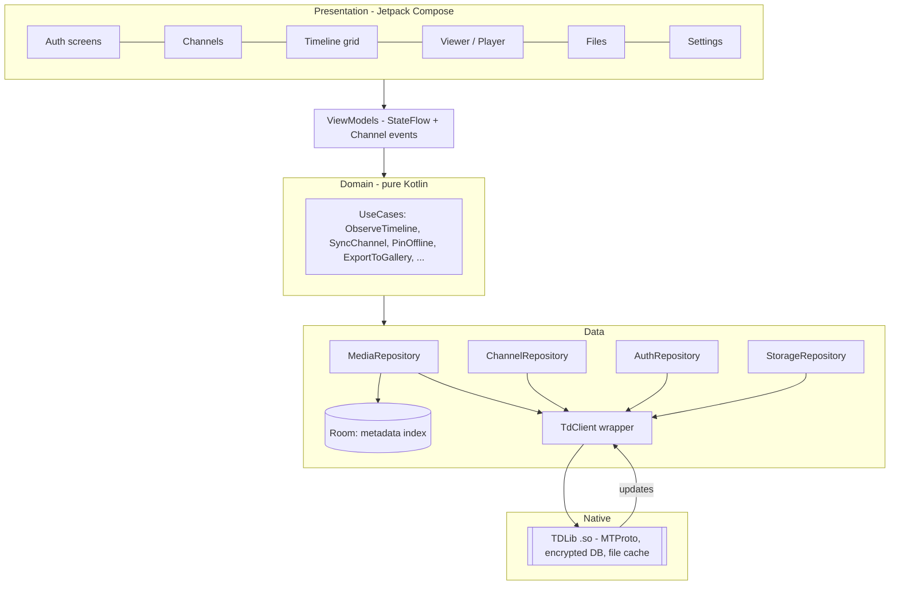
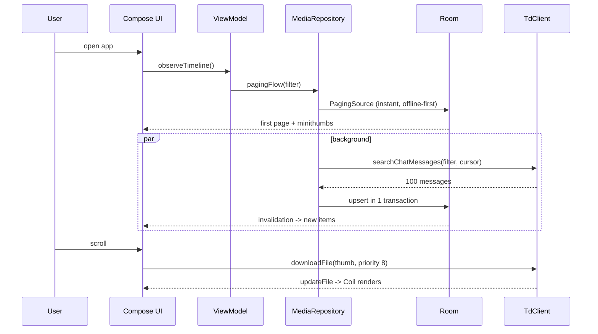
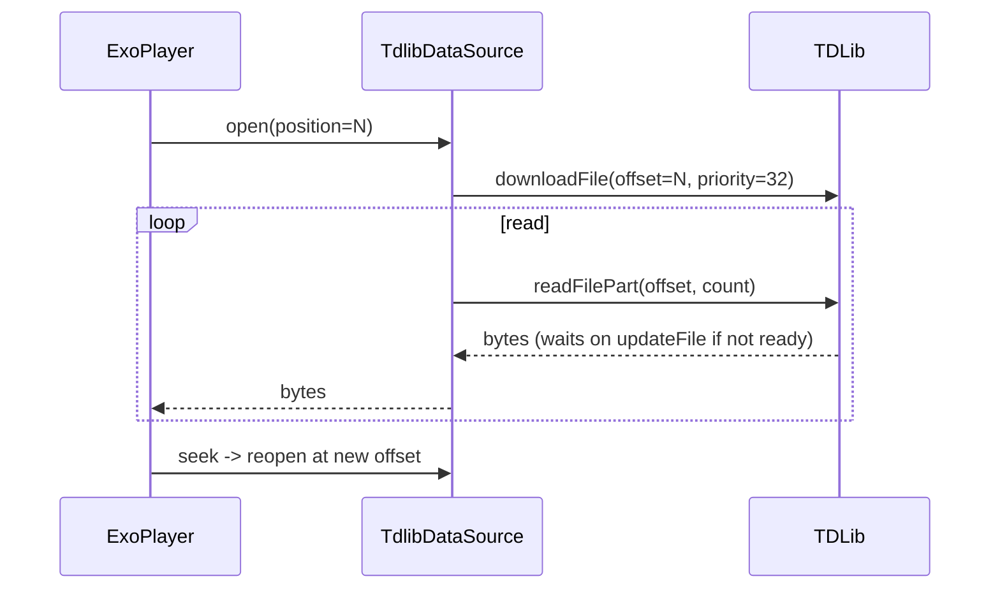

# TeleGallery — Production Architecture, System Design & Security

> Android app that turns the photos, videos and files of one or more Telegram channels into a Google-Photos-style gallery.
> Audience: engineer / AI coding agent (Antigravity, Gemini) implementing the app. Version 1.0 · Nov 2026.

---

## 0. Final decisions (locked)

| Area | Decision |
|---|---|
| Channel access | User is **admin (or creator)** of every channel shown |
| Login | **User account** (phone → code → optional 2FA password, or QR login) via MTProto |
| Media | **All**: photos, videos, GIF/animations, audio, documents/files (including images/videos sent *as files*) |
| Telegram client library | **TDLib, native** (JNI `.so`), official Java bindings `org.drinkless.tdlib` |
| Storage | **Hybrid** (see §6) |
| Channels | **Multi-channel**, unified or per-channel timeline |
| Theme | **Light + Dark + System** (Material 3, dynamic colour off by default to keep brand accent) |
| Platform | Android **9+ (minSdk 28)**, targetSdk 35, Kotlin, Jetpack Compose |
| Write access | **None.** App is strictly read-only on Telegram (enforced in code, §8.3) |

### Why TDLib + user login (not the Bot API)
The Bot API cannot read a channel's message history. Only a user (or MTProto client) session can list old messages. TDLib is Telegram's official client library: it handles MTProto, encryption, update sync, file download/resume and its own local database, which is why it is the right base for a fast, low-bug app.

### Honest expectations
No app can *guarantee* zero crashes on every device. This document gives the design, guardrails, test matrix and release gates that bring crash-free sessions to the 99.9 % range. Performance numbers below are **targets to be verified** on real devices, not promises.

---

## 1. Product scope

**Must have (v1.0)**
1. Login with phone + code (+ 2FA password), logout.
2. List channels where the user is admin; pick one or many to "add" to the gallery.
3. Unified **timeline grid** (date-grouped, fast-scroll with month bubble) per channel or "All channels".
4. Filters: All · Photos · Videos · Files · Audio · GIFs. Sort newest/oldest.
5. Full-screen photo viewer (pinch-zoom, swipe), **video streaming player** (seek before fully downloaded), file/document list with open/share.
6. Hybrid offline: pin items offline, export to phone gallery, cache limit.
7. Live updates: new uploads to the channel appear automatically.
8. Search by caption / file name. Selection mode: save, share, pin offline.
9. Light/Dark theme, App lock (biometric), Wi-Fi-only downloads.

**Out of scope v1:** uploading, deleting or editing channel content, comments, bots, secret chats, multi-account.

---

## 2. Reality checks about Telegram media (these decide the design)

1. **Photos uploaded "as file"** are `messageDocument` with an `image/*` MIME, *not* `messagePhoto`. They may have only a small thumbnail. The app must classify by MIME/extension, not by message type alone, and generate its own grid thumbnails for them (§5.4).
2. **`file.id` is session-local; `file.remote.unique_id` is stable.** Primary key of a media item is `(chat_id, message_id)`; use `unique_id` for cache keys and de-duplication.
3. **`minithumbnail`** (tiny inline JPEG, ≈ 40 px) is delivered with the message metadata. Use it as an instant blurred placeholder so the grid never looks empty.
4. **Albums** (media groups) are several messages sharing `media_album_id`. Show them as individual grid cells (Google Photos style); optionally badge as stack.
5. **Server-side filtering is available**: `searchChatMessages` with `searchMessagesFilterPhotoAndVideo / Document / Audio / Animation` returns only matching messages, so we never walk the whole history message-by-message. `getChatMessageCount` gives totals; `getChatMessageCalendar` gives per-day counts (used for fast-scroll).
6. **Rate limits**: expect `FLOOD_WAIT`-style errors (code 429, `retry_after`). The client must back off, never hammer.
7. **File size limits**: up to 2 GB per file (4 GB for Premium uploaders). Videos can be huge → streaming, not full download.
8. **Terms**: you must register your own `api_id` / `api_hash` at my.telegram.org and follow Telegram API Terms of Service (no spam, no abuse of rate limits, don't mimic the official app's identity).

---

## 3. High-level architecture



### 3.1 Principles
- **Single source of truth for UI = Room.** UI never reads TDLib objects directly. TDLib → mapper → Room → Paging → UI. This keeps UI fast, offline-capable and decoupled from TDLib's evolving API.
- **Unidirectional data flow**: `Event → ViewModel → State (StateFlow)`; one-shot effects through `Channel`.
- **Clean layering**: `ui → domain → data`. `domain` has zero Android imports (unit-testable).
- **One TDLib client per process**, owned by an app-scoped singleton, started lazily on a dedicated thread and never created in an Activity.
- **Read-only gateway** (§8.3).

### 3.2 Tech stack

| Concern | Choice | Reason |
|---|---|---|
| Language/UI | Kotlin 2.x, Compose + Material 3, Navigation-Compose (type-safe routes) | Lowest boilerplate, good perf with stable keys |
| DI | Hilt | Standard, compile-time checked |
| Async | Coroutines + Flow | Structured concurrency, cancellation |
| Local DB | Room (KSP) + Paging 3 `RemoteMediator`-style sync | Efficient windowed grid |
| Images | Coil 3 with custom `TdFileFetcher` | Memory/disk caching, downsampling, Compose-native |
| Video/Audio | Media3 ExoPlayer with custom `TdlibDataSource` (uses `readFilePart`) | Streaming while downloading |
| Zoomable image | Telephoto `ZoomableImage` (sub-sampling) or equivalent | Big images without OOM |
| Prefs | DataStore (Proto or Preferences) | No main-thread I/O |
| Background | WorkManager (+ foreground service type `dataSync`) for offline pin queue | Survives process death |
| Biometrics | `androidx.biometric` | App lock |
| Build | Gradle version catalog, R8 full mode, Baseline Profiles, ABI splits / AAB | Startup + size |
| Logging | Timber (debug only) | No PII in release |

Versions: pin latest **stable** releases at implementation time; do not use alpha/beta in production.

---

## 4. Module & package structure

Keep modules coarse to protect build times.

```
:app                      Application, MainActivity, nav graph, Hilt root
:core:model               Pure Kotlin data classes (MediaItem, Channel, ...)
:core:tdlib               TdClient wrapper, mappers, ReadOnlyGateway, JNI loader
:core:database            Room entities, DAOs, migrations
:core:media               Coil fetcher, Media3 data source, thumbnail generator
:core:designsystem        Theme, colors, type, shared components (Grid cell, Chip, ...)
:feature:auth             Phone/code/password/QR screens
:feature:channels         Admin channel list, add/remove channels
:feature:gallery          Timeline grid, filters, selection, fast-scroll, search
:feature:viewer           Photo pager, video player, file preview
:feature:settings         Storage, theme, app lock, account
```

Package convention inside a feature: `ui/` (Composables, ViewModel), `domain/` (use cases), `data/` (repo impls).

---

## 5. Core subsystems

### 5.1 TdClient wrapper (`:core:tdlib`)

- `Client.create(updateHandler, exceptionHandler, exceptionHandler)`; every `client.send(function, resultHandler)` is wrapped as `suspend fun <R : TdApi.Object> TdClient.execute(f: TdApi.Function<R>): Result<R>` using `suspendCancellableCoroutine`. Errors (`TdApi.Error`) map to a sealed `TdError` (`FloodWait(seconds)`, `Network`, `Unauthorized`, `NotFound`, `Other`).
- Updates are emitted into a `SharedFlow<TdApi.Update>` (extraBufferCapacity 256, `DROP_OLDEST` for non-critical, dedicated critical flow for auth state). Handler must **never block** — hand off immediately to a coroutine on `Dispatchers.Default`.
- Parameters at startup (`setTdlibParameters`): `api_id`, `api_hash` (BuildConfig from CI secret), `database_directory = filesDir/td/db`, `files_directory = filesDir/td/files`, `use_file_database = true`, `use_chat_info_database = true`, `use_message_database = true`, `database_encryption_key` (§8.1), `system_language_code`, `device_model`, `application_version`.
- Call `setLogVerbosityLevel(0)` (or 1) in release; disable TDLib log files.
- Auth state machine exposed as `StateFlow<AuthState>`:
  `WaitParameters → WaitPhone | WaitQr → WaitCode → WaitPassword → Ready → LoggingOut/Closed`.
- Lifecycle: initialise in `Application.onCreate` **off the main thread**; never call `close` on config changes.

### 5.2 Channel discovery (admin only)

1. `loadChats(chatListMain, 100)` repeated until 404, collect `Chat` where `type is ChatTypeSupergroup && isChannel`.
2. For each, `getChatMember(chatId, MessageSenderUser(myId))` → keep when status is `ChatMemberStatusCreator` or `ChatMemberStatusAdministrator`.
3. Show them in the **Channels** screen; user toggles which to include (`channel.enabled` in Room).
4. Re-validate admin status on every cold start and on `updateChatMember`; if lost, disable the channel and show a banner (data remains cached until user removes it).

### 5.3 Media indexing & sync (the heart of the app)

**Goal:** the timeline works instantly from Room while a background sync fills it in.

Per channel and per media filter (`PhotoAndVideo`, `Document`, `Audio`, `Animation`):

1. **Initial backfill** — call `searchChatMessages(chatId, query="", fromMessageId=cursor, offset=0, limit=100, filter)` repeatedly, newest → oldest, until empty. Each page is mapped and inserted in a single Room transaction. Persist `SyncState(chatId, filter, oldestMessageId, complete)` after every page so the job is **resumable after process death**.
2. **Live updates** — handle `updateNewMessage`, `updateMessageContent`, `updateDeleteMessages`, `updateMessageSendSucceeded` for enabled channels → upsert/delete in Room.
3. **Gap repair** — on app start, fetch the newest page and compare with `SyncState.newestMessageId`; walk back until overlap.
4. **Totals** — `getChatMessageCount` per filter drives "12,480 items" and sync progress (%).
5. **Throttling** — one in-flight search per channel; on `FloodWait(n)` delay `n + jitter` seconds; max 2 channels syncing concurrently (1 on low-RAM devices).
6. **Priority** — if the user is looking at channel X, X's sync jumps the queue.

**Classification rules** (`MediaKind`): `PHOTO`, `VIDEO`, `ANIMATION`, `AUDIO`, `IMAGE_FILE` (document with `image/*`), `VIDEO_FILE` (document with `video/*`), `FILE` (everything else). The grid treats `IMAGE_FILE`/`VIDEO_FILE` exactly like photo/video; the *Files* tab lists `FILE` + `AUDIO`.

### 5.4 Thumbnails

| Source | Strategy |
|---|---|
| Photo / video / animation | Use TDLib's thumbnail file (smallest size ≥ 256 px) → download with priority 8 when cell becomes visible, cancel when it leaves |
| Image sent as file (no usable thumb) | Download original only if ≤ 8 MB, decode with `inSampleSize` to 320 px, store WebP (q 80) in app thumbnail cache; larger → show type icon + `minithumbnail` and generate lazily when scrolled-to rest |
| Video sent as file | TDLib thumbnail if present, else placeholder with play badge (no auto-download of video body) |
| Any | `minithumbnail` blurred placeholder first (0 ms), real thumb cross-fades in |

Own thumbnail cache: `cacheDir/thumbs`, WebP, key = `unique_id`, LRU max **200 MB** (≈ 100 MB on low-RAM devices).

### 5.5 Image loading pipeline (Coil)

- `TdFileFetcher` resolves a `TdFileRef(fileId, uniqueId)` → starts `downloadFile(priority, offset=0, limit=0, synchronous=false)` and suspends until `updateFile` reports `isDownloadingCompleted`; supports cancellation by calling `cancelDownloadFile` on coroutine cancel.
- Memory cache: 15 % of `memoryClass` (10 % if `isLowRamDevice`). Disk cache disabled in Coil (we already persist files in TDLib/own cache).
- Grid requests decode at **cell size × density** with `Bitmap.Config.RGB_565` allowed for thumbnails on low-RAM devices; `allowHardware(true)`.
- Viewer: decode to screen size; sub-sampling for images > 4096 px.
- **Cancel on scroll**: Coil request is bound to the composable; leaving composition cancels.

### 5.6 Video streaming (`TdlibDataSource`)

- Implements Media3 `DataSource`. On `open(dataSpec)` call `downloadFile(fileId, priority=32, offset=dataSpec.position, limit=0, synchronous=false)`; `read()` pulls bytes via `readFilePart(fileId, offset, count)` and waits (with timeout) for `updateFile` when the requested range is not yet downloaded.
- `supportsStreaming` is honoured; if the file is not streamable (rare), show progress UI and play after complete download.
- Buffering: `DefaultLoadControl` min 2.5 s / max 15 s (low-RAM: 1.5 s / 8 s). One `ExoPlayer` instance reused across pager pages (never one per page).
- Release player in `onStop`, restore position in `onStart`. Handle `PlaybackException` with retry (exponential, max 3) then error card with "Retry" and "Open elsewhere".
- Picture-in-picture: nice-to-have (v1.1).

### 5.7 Timeline grid (`:feature:gallery`)

- `LazyVerticalGrid` with `GridCells.Adaptive(~110.dp)` (3 columns on phones), `key = { it.stableId }`, `contentType` per cell type.
- Source: `Pager(PagingConfig(pageSize = 120, prefetchDistance = 60, enablePlaceholders = true, maxSize = 1200))` over a Room `PagingSource` ordered by `date DESC`, filtered by channel set + media filter.
- Date headers via `insertSeparators` (Today, Yesterday, weekday, "3 Oct", then month/year). Header is sticky.
- **Fast scroll**: query `SELECT strftime('%Y-%m', date,'unixepoch') AS ym, COUNT(*) FROM media WHERE ... GROUP BY ym` (indexed) → builds a position map so dragging the scroll thumb shows the "Oct 2026" bubble and jumps accurately in O(1).
- **Selection mode**: long-press → multi-select; drag-to-select across cells; actions Save / Share / Pin offline / Hide.
- Pinch to change grid density (2–5 columns), persisted.
- Cell composable rules: no lambda allocation in hot path, `@Stable` UI models, no `remember` of heavy objects per cell, **no `Modifier.animateItem` in the hot path on low-RAM devices**.

### 5.8 Viewer (`:feature:viewer`)
- `HorizontalPager` over the same paging source (position-based), `beyondViewportPageCount = 1`.
- Prefetch next/prev original at low priority only when on Wi-Fi (or unmetered setting off).
- Gestures: pinch/double-tap zoom, vertical swipe to dismiss, tap to hide chrome. Bottom bar: Save to phone · Share · Info · Hide.
- Info sheet: date, size, dimensions, duration, caption, channel, original file name.

### 5.9 Files tab
List grouped by type (Documents, Audio, Archives, Other). Tap → download if needed (progress + cancel) → open with `ACTION_VIEW` via `FileProvider` (never expose raw paths). Audio plays in the shared Media3 session.

---

## 6. Hybrid storage design

```
┌────────────────────────────── Phone storage ──────────────────────────────┐
│ L0  Room DB (metadata index, tiny)            always local, never evicted  │
│ L1  Thumbnails (TDLib thumb files + own WebP)  persistent, LRU 200 MB      │
│ L2  Originals cache (TDLib files dir)          on-demand, LRU cap 3 GB*    │
│ L3  Pinned offline (immunity from eviction)    user-chosen                 │
│ L4  Exported copies (MediaStore: Pictures/TeleGallery) user-chosen         │
└──────────────────────────────────────────────────────────────────────────┘
          Telegram cloud = the permanent original source of truth
* default = min(3 GB, 10 % of free space); 512 MB when isLowRamDevice
```

- **L0** metadata means the whole library is browsable instantly and offline.
- **L2 eviction**: call `optimizeStorage(size = cap, ttl = -1, count = -1, immunityDelay = 600, fileTypes = [Photo, Video, Document...], chatIds = [], excludeChatIds = [], returnDeletedFileStatistics = false, chatLimit = 0)` on app start (if over cap), after large downloads, and from Settings → Clear cache. Never eviction while the file is in the viewer or pinned.
- **L3 Pin offline**: stored in Room (`pinned = true`) + a WorkManager queue downloading originals; pinned files are copied to `filesDir/pinned/` (so TDLib's optimizer can't delete them) and referenced by path.
- **L4 Export**: Android 10+ → `MediaStore.Images/Video/Downloads` with `IS_PENDING` pattern into `Pictures/TeleGallery` — **no storage permission needed**. Android 9 (API 28) → request `WRITE_EXTERNAL_STORAGE` only at the moment of first export, scoped with `maxSdkVersion="28"` in the manifest.
- Low free space: if free < 500 MB, pause background downloads and show a non-blocking banner.
- Wi-Fi-only toggle applies to L3 queue and viewer prefetch (not to explicit user taps unless "strict" mode).

---

## 7. Data model (Room)

```kotlin
@Entity(tableName = "channel")
data class ChannelEntity(
  @PrimaryKey val chatId: Long,
  val title: String, val username: String?, val photoFileId: Int?, val minithumb: ByteArray?,
  val enabled: Boolean, val isAdmin: Boolean, val totalMedia: Int, val lastSyncAt: Long
)

@Entity(
  tableName = "media",
  primaryKeys = ["chatId", "messageId"],
  indices = [Index("chatId","date"), Index("kind","date"), Index("uniqueId"), Index("date")]
)
data class MediaEntity(
  val chatId: Long, val messageId: Long, val albumId: Long,
  val uniqueId: String, val fileId: Int, val thumbFileId: Int?, val minithumb: ByteArray?,
  val kind: Int,            // MediaKind ordinal
  val mime: String?, val fileName: String?, val sizeBytes: Long,
  val width: Int, val height: Int, val durationSec: Int,
  val date: Long,           // epoch seconds (message date)
  val caption: String?,
  val pinned: Boolean, val localPath: String?, val hidden: Boolean
)

@Entity(tableName = "sync_state", primaryKeys = ["chatId","filter"])
data class SyncStateEntity(
  val chatId: Long, val filter: Int,
  val oldestMessageId: Long, val newestMessageId: Long, val complete: Boolean
)

@Fts4(contentEntity = MediaEntity::class) @Entity(tableName = "media_fts")
data class MediaFts(val caption: String?, val fileName: String?)
```

Rules: `fileId` is refreshed from TDLib on every session (map `uniqueId → fileId` lazily through `getMessage`/`getRemoteFile`); never trust a persisted `fileId` across logins. Migrations are written and tested (`MigrationTestHelper`); destructive migration is **forbidden** in release (the DB can be rebuilt from Telegram but must not lose pins/hidden flags).

---

## 8. Security

### 8.1 Secrets & encryption at rest
| Asset | Protection |
|---|---|
| TDLib database (messages, auth keys) | TDLib `database_encryption_key`: 32 random bytes generated once, **wrapped with an Android Keystore AES-256-GCM key** (hardware-backed, StrongBox if available), wrapped blob stored in DataStore. Never stored in plaintext, never logged. |
| Room metadata DB | Contains channel titles, captions, file names → treat as sensitive. Use SQLCipher *or* store DB in no-backup dir protected by file-based encryption (FBE, default on Android 9+ devices). Decision: **FBE + no-backup** for v1 (keeps APK small/fast); SQLCipher is an optional hardening flag. |
| Thumbnails / pinned files | App-private dirs (`filesDir`, `cacheDir`), no world access |
| `api_id` / `api_hash` | Injected from CI secrets / `local.properties` into `BuildConfig`; not committed. Note: extractable from any APK — accept, they are app identifiers not user secrets; rotate if abused. |
| 2FA password | Held only in memory during `checkAuthenticationPassword`, cleared immediately, never persisted |

### 8.2 App & platform hardening
- `android:allowBackup="false"`, `dataExtractionRules` and `fullBackupContent` exclude everything.
- `android:usesCleartextTraffic="false"`; `network_security_config` denies user-added CAs for release. (MTProto is its own encrypted transport; HTTPS is only for optional update checks.)
- All components `exported="false"` except launcher activity. `FileProvider` with narrow `paths.xml`.
- `FLAG_SECURE` on viewer/player when **Privacy mode** is on; also hides app preview in Recents.
- **App lock**: biometric/device credential after 30 s in background (configurable). API 28–29 limitation: `BIOMETRIC_STRONG | DEVICE_CREDENTIAL` combination is not supported → on those versions use biometric prompt with a "Use screen lock" fallback via `KeyguardManager.createConfirmDeviceCredentialIntent`.
- R8 full mode + keep rules for TDLib JNI classes (`-keep class org.drinkless.tdlib.** { *; }`); strip logging.
- Play Integrity API check is optional (informational only); do not hard-block rooted users.
- Dependencies: Gradle dependency verification (checksums), Dependabot/Renovate, `./gradlew dependencyCheckAnalyze` (OWASP) in CI.
- Release signing via Play App Signing; upload key in CI secret store.

### 8.3 Read-only gateway (defence in depth)
All TDLib calls go through `ReadOnlyGateway`, an **allow-list** of function classes (`GetChats`, `LoadChats`, `GetChat`, `GetChatMember`, `SearchChatMessages`, `GetChatMessageCount`, `GetChatMessageCalendar`, `GetMessage`, `GetMessages`, `DownloadFile`, `CancelDownloadFile`, `ReadFilePart`, `GetFile`, `OptimizeStorage`, auth functions, `LogOut`, `SetOption`, …). Anything else (`SendMessage`, `DeleteMessages`, `EditMessage*`, `SetChat*` …) throws `IllegalStateException` in debug and is dropped in release. A unit test enumerates the allow-list so additions are reviewed.

### 8.4 Privacy
- No analytics SDKs by default. Optional crash reporting is **opt-in**, scrubbed of phone numbers/captions/file names/URLs.
- No ads, no third-party trackers, no clipboard reads, no contacts permission.
- Permissions: `INTERNET`, `ACCESS_NETWORK_STATE`, `POST_NOTIFICATIONS` (only for the offline queue, requested lazily), `FOREGROUND_SERVICE` + `FOREGROUND_SERVICE_DATA_SYNC`, `USE_BIOMETRIC`, `WRITE_EXTERNAL_STORAGE` (`maxSdkVersion=28`). Nothing else.
- Logout = `LogOut` + wipe `td/`, Room, thumbnails, pinned files, DataStore, Keystore alias.
- Provide in-app privacy notice + Play Data-safety form: data is processed on-device; account data goes only to Telegram.

### 8.5 Threat model (summary)
| Threat | Mitigation |
|---|---|
| Lost/stolen unlocked phone | App lock, FLAG_SECURE, quick "Lock now" |
| Malware reads app files | App-private storage, FBE, Keystore-wrapped TDLib key, no backup |
| Tampered APK | Play signing, optional Play Integrity signal, R8 |
| Account hijack through phishing UI | Auth only through TDLib, never WebView; clear "Telegram sends the code in your Telegram app" copy |
| Accidental destructive action | Read-only gateway |
| Rate-limit ban | Throttled sync, FloodWait back-off, concurrency caps |
| Data leakage through logs | Release logs disabled, PII scrubber |

---

## 9. Performance & stability engineering

### 9.1 Targets (verify on test devices; Android 9 / 2 GB RAM is the reference "slow" device)
| Metric | Target |
|---|---|
| Cold start → first grid frame (warm DB) | ≤ 1.2 s mid-range, ≤ 2.0 s reference slow device |
| Thumbnails visible after scrolling stops | ≤ 300 ms (minithumb instantly) |
| Janky frames in grid scroll | < 2 % (JankStats / macrobenchmark) |
| Steady RAM in gallery | < 250 MB (< 150 MB on low-RAM) |
| Install size (arm64 AAB-delivered) | aim ≤ 25 MB; check after TDLib build |
| Battery | no background work when app closed except user-queued pins |

### 9.2 How we get there
- **Baseline Profile + Startup Profile** generated by Macrobenchmark; `androidx.profileinstaller`.
- App start does only: Hilt graph (lazy), DataStore read, open Room. TDLib starts on a background thread; UI renders from Room immediately ("offline-first").
- Compose: stable keys, `derivedStateOf`, immutable collections, hoisted state, strong skipping on; avoid nested scrollables; verify with Compose compiler metrics + Layout Inspector recomposition counts.
- **Disk/IO off main** (StrictMode `penaltyDeath` in debug only).
- Bitmaps: no full-size decode in grid; reuse via Coil pool; downscale in viewer.
- TDLib JNI: build with `-Os`/LTO, stripped; ship `arm64-v8a` + `armeabi-v7a` (x86_64 only in debug/emulator builds). **Align native libs for 16 KB pages** (NDK r28+ default) — required for current Play targets.
- R8 full mode + resource shrinking; WebP/vector assets; no unused locale bundles (`resourceConfigurations`).
- Low-end mode (auto when `ActivityManager.isLowRamDevice` or memoryClass ≤ 128): 2 columns default, smaller caches, 1 sync thread, no thumbnail cross-fade animation, RGB_565 thumbs.

### 9.3 Crash-proofing checklist
1. **No `!!`** in production code (detekt rule), no unchecked casts on TDLib objects (`when` with `else`).
2. Every coroutine launched in a structured scope with `CoroutineExceptionHandler`; repository functions return `Result`/sealed states, never throw to UI.
3. TDLib update handler wrapped in `try/catch`; a bad update is dropped and counted, never crashes the process.
4. Process death: ViewModels use `SavedStateHandle`; sync resumes from `SyncState`.
5. Config changes (rotation, dark mode, font scale, locale) handled with no state loss; foldables/tablets use adaptive grid width.
6. Handle: no network, airplane mode, captive portal, VPN switch, `FloodWait`, revoked session (`AuthorizationStateLoggingOut`), deleted channel / lost admin, deleted message while viewing, disk full (`ENOSPC`), Keystore invalidation (reset flow instead of crash), permission denial.
7. OOM guard: `onTrimMemory` → clear Coil memory cache, cancel prefetch.
8. ANR guard: no `runBlocking`, no synchronous TDLib `execute` for network calls, BroadcastReceiver/Service work < 10 s, foreground service started within 5 s.
9. Android 14/15 specifics: declare foreground-service types; `dataSync` FGS has a time limit on Android 15 — queue must resume gracefully via WorkManager.
10. Debug tooling: LeakCanary, StrictMode, Compose runtime tracing — **debug builds only**.

### 9.4 Testing & release gates
| Level | What |
|---|---|
| Unit | Mappers (message → MediaEntity incl. "image as file"), classifier, sync cursor logic, FloodWait back-off, allow-list gateway, eviction math |
| Integration | Room migrations, Paging source, fake `TdClient` replaying recorded updates |
| UI | Compose tests: login states, grid selection, theme switching, process-death restore |
| Macrobenchmark | Startup, scroll 10 000 items, viewer swipe |
| Device matrix (Firebase Test Lab or real) | API 28, 29, 30, 33, 34, 35 · 2 GB / 4 GB / 8 GB RAM · small (360×640) and large screens · arm64 + armv7 |
| Soak | 30-min scroll+video loop, memory graph must be flat |
| Gates | Crash-free sessions ≥ 99.9 % in staged rollout (1 % → 10 % → 50 % → 100 %), ANR < 0.1 %, startup & jank budgets met |

CI (GitHub Actions or equivalent): lint, detekt, ktlint, unit tests, assemble, Macrobenchmark on managed device, dependency verification, signed AAB artefact.

---

## 10. UI / UX specification

Screenshots (mockups) are in `screenshots/` — see `00_overview.png`. HTML sources in `ui-mockups-html/`.

### 10.1 Design tokens
| Token | Dark | Light |
|---|---|---|
| Background | `#10161E` | `#F5F6F2` |
| Surface | `#18212C` | `#FFFFFF` |
| Surface-variant | `#202B38` | `#E9ECE6` |
| Text | `#EAF0F6` | `#141A21` |
| Muted | `#8A9BAE` | `#5F6B77` |
| Accent (marigold) | `#F0AE45` | `#B8710F` |
| Divider | `#263344` | `#DDE1D8` |

Typography: Inter (bundled, variable, subset Latin) — 12 / 13 / 14 / 16 / 19 / 28 sp scale; weights 500/600/700. Bengali and other scripts fall back to the system font (Noto) so no extra font weight is shipped. Corner radius: 14 dp cards, 12 dp buttons, full pill for chips. Grid gap 2 dp, edge-to-edge.

### 10.2 Screens
| # | Screen | Key points |
|---|---|---|
| 01 | Login | Phone → code → 2FA password; QR option; clear read-only copy |
| 02 | Channels | Admin badge, item count, sync progress; "Add channel" |
| 03 / 04 | Timeline (dark / light) | Channel switcher, filter chips, sticky date headers, video badge + duration, fast-scroll bubble |
| 05 | Files | Type tiles, size, channel, selection |
| 06 | Photo viewer | Edge-to-edge, pinch zoom, bottom actions |
| 07 | Video player | Streaming status, seek bar with buffered range |
| 08 | Settings | Storage meter + limit, theme (Light/Dark/System), app lock, Wi-Fi only, account/log out |

### 10.3 Empty / error / loading states (required)
- **Empty channel list:** "No channels found. You must be an admin of a channel to see it here." + Refresh.
- **Syncing:** top thin progress, "Indexing 3,120 of 12,480" — grid usable meanwhile.
- **Offline:** banner "You're offline. Showing saved items." Items without cached original show lock-free "Not downloaded" badge.
- **Item failed:** tile shows retry glyph; tap retries.
- **Lost admin rights:** banner on channel, read-only cached content.
- Copy style: sentence case, active voice, errors say what happened and what to do.

### 10.4 Accessibility
Min touch 48 dp, content descriptions for media (type + date), TalkBack order sensible, dynamic font to 200 %, contrast ≥ 4.5:1 (both themes verified), reduce-motion respected, focus indicators for keyboard/TV remotes.

---

## 11. Key sequences





---

## 12. Build & delivery

- Gradle: version catalog, convention plugins, configuration cache, build cache ON.
- **TDLib build**: reproducible script `tools/build-tdlib.sh` using official `td/example/android` instructions, pinned TDLib commit/tag, NDK r28+, OpenSSL static, `-Os`, LTO, strip, ABIs `arm64-v8a`,`armeabi-v7a`. Output `core/tdlib/src/main/jniLibs/<abi>/libtdjni.so` + Java bindings. Store checksums in the repo; verify in CI. (A community prebuilt AAR may be used for prototyping only; production uses the self-built, verified one.)
- Variants: `debug` (all ABIs, tooling) / `release` (R8, profile, no logs). Flavors not needed.
- Versioning: `versionCode` from CI build number; semantic `versionName`.
- Distribution: Play Console AAB with ABI/density splits; staged rollout; Play Data-safety + privacy policy URL.
- Observability (opt-in): Crashlytics or self-hosted Sentry; Play Console vitals as primary source.

---

## 13. Implementation roadmap

| Phase | Output | Exit criteria |
|---|---|---|
| 0 | Project skeleton, modules, CI, theme, TDLib build script | App launches (light/dark), CI green |
| 1 | `:core:tdlib` wrapper + auth flow | Login/logout works on real account, state survives process death |
| 2 | Channels (admin filter) + Room schema | Admin channels listed and toggled |
| 3 | Sync engine + classifier | Full history indexed, resumable, FloodWait handled |
| 4 | Timeline grid + filters + fast-scroll | 10k items scroll within jank budget |
| 5 | Viewer + video streaming + files | Seek-before-complete works; no leaks |
| 6 | Hybrid storage: eviction, pin, export | Cache cap enforced; export works on API 28 and 29+ |
| 7 | Security: app lock, key wrapping, FLAG_SECURE, allow-list gateway | Pen-test checklist passed |
| 8 | Performance: baseline profiles, low-end mode, soak tests | All §9.1 targets met |
| 9 | Beta → staged rollout | Crash-free ≥ 99.9 % |

---

## 14. Risks & open questions

| Risk | Plan |
|---|---|
| TDLib API changes between versions | Pin version; isolate behind `:core:tdlib` mappers; contract tests |
| Huge channels (100k+ items) | Paging + indexed queries + `maxSize` window; sync in background with progress |
| "Image as file" without thumbnail on slow devices | Lazy generation with size cap, placeholder icon fallback |
| Telegram policy / API-ID abuse flags | Respect rate limits, own api_id, no scraping other people's channels (admin-only by design) |
| Play policy on foreground-service use | Only for user-initiated offline downloads; declare clearly |
| Android 9 specifics (no scoped storage, biometric limits) | Handled in §6 and §8.2 |
